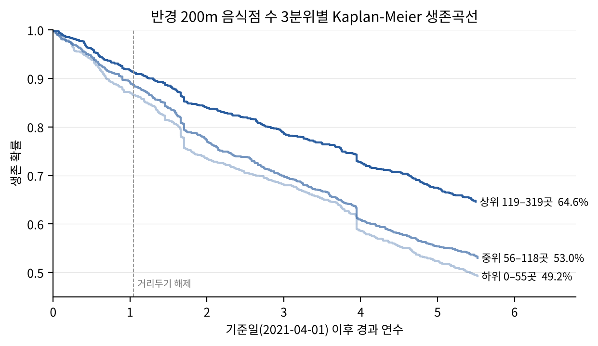
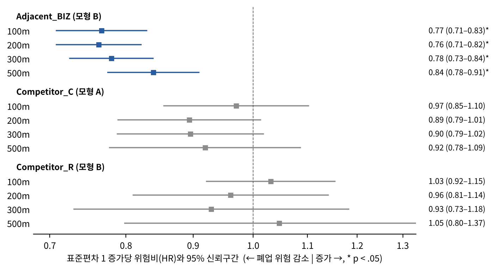

# 성동구 F&B 점포 생존 분석: 경쟁 네트워크 · 네이버 리뷰 · System Dynamics

서울시 성동구 일반음식점의 폐업 위험을 **반경 경쟁 변수와 경쟁 네트워크 구조**로 설명하고(Cox 비례위험모형),
추정 결과를 System Dynamics 정책 시뮬레이션에 연결하는 연구의 코드와 데이터입니다.

## 진행 현황 (2026-10-16 기준)

| 단계 | 내용 | 상태 |
|---|---|---|
| 데이터 구축 | 인허가·상권·매출·임대료 결합, 네이버 리뷰 매칭 | 완료 |
| 경쟁 변수 | 반경 100·200·300·500m Competitor_C / Adjacent_BIZ / Competitor_R | 완료 |
| 경쟁 네트워크 변수 | 반경별 가중 연결강도 · 매개중심성 · 군집계수 | 완료 |
| 생존분석 | Kaplan-Meier, 반경별 Cox 모형(H1–H3), 네트워크 Cox 모형(H4), 강건성 검토 | 완료 |
| 확장 분석 | 시간가변 공변량 모형, 코로나 기간 상호작용, 리뷰 결합 분석 | 예정 |
| System Dynamics | 추정 계수를 이식한 정책 시나리오 시뮬레이션 | 예정 |

## 연구 설계

- **기준 집단**: 2021-04-01(2021년 1분기 말) 영업 중인 성동구 일반음식점 **3,775개**
- **관찰 기간**: 2021-04-01 ~ 2026-10-13(인허가 데이터 추출일), 폐업 **1,677개(44.4%)**, 나머지는 우측 중도절단
- **Cox 분석 표본**: 상권 매출이 결측인 808곳(업종 미분류 780곳 포함)을 제외한 **2,967개**(폐업 1,267개)
- **연구 질문**
  - RQ1. 반경 기반 경쟁 변수를 통제한 뒤에도 경쟁 네트워크 구조가 폐업 위험을 추가로 설명하는가?
  - RQ2. 경쟁 범위(반경·상권 정의)는 어떻게 정해야 폐업 위험을 가장 잘 설명하는가?
  - RQ3. 추정한 생존 요인을 SD 모형에 넣으면 정책 시나리오별 상권은 어떻게 변하는가?
- **가설**
  - H1 (동종 경쟁): 같은 업태 이웃 수(C)와 비율(R)이 클수록 폐업 위험이 높다.
  - H2 (집적): 전체 음식점 수(BIZ)가 클수록 폐업 위험이 낮다.
  - H3 (공간 범위): H1·H2의 효과는 반경이 작을수록 크다.
  - H4 (네트워크): 반경 변수를 통제한 뒤에도 네트워크 지표가 폐업 위험을 추가로 설명한다.

## 주요 결과

모든 Cox 모형은 업력, 임대료 수준(low/mid/high), 상권 점포당 매출(log), 업태 더미를 통제했고,
상권 단위 군집 강건 표준오차(72개 군집)를 사용했습니다. 전체 수치는 [`outputs/results_summary.md`](outputs/results_summary.md)에 있습니다.

| 가설 | 결과 | 근거 |
|---|---|---|
| H1 동종 경쟁 | 기각 | C·R 모두 네 반경에서 5% 수준으로 유의하지 않음 (C의 HR은 1 미만, 200·300m에서 p < .10) |
| H2 집적 | 지지 | 100m 안 음식점이 10곳 많을수록 폐업 위험 7.9% 감소 (HR 0.921, 95% CI 0.899–0.944) |
| H3 공간 범위 | 대체로 지지 | 표준편차 1 증가당 BIZ의 HR이 100·200m 0.77·0.76 → 500m 0.84로 약해짐 |
| H4 네트워크 | 부분 지지 | 100m(LR χ²(3) = 18.2, p < .001)와 200m(10.0, p = .019)에서 네트워크 지표의 증분 설명력이 유의. 가까운 동종 경쟁자에 촘촘히 둘러싸일수록(연결강도 1 SD당 HR 1.31, 200m 1.17) 폐업 위험 증가 |

- 반경 200m 음식점 수 상위 1/3 집단의 관찰 종료 시점 생존율은 64.6%로, 하위 1/3(49.2%)보다 15.4%p 높습니다(log-rank p < .001, 전체 3,775곳).
- 결론은 임대료 처리 방식(범주형·연속형·동 고정효과), 매출 변수 제외(매출 결측 점포 포함 전체 3,775곳), 일괄 폐업일 제외, 표준오차 보정 방식에 관계없이 유지됩니다.
- 비례위험 가정: Adjacent_BIZ와 Competitor_C는 위반 없음(최소 p = .365, .073). Competitor_R은 200·300·500m에서 위반 신호(p = .013–.032)가 있어, R의 계수를 관찰 1년 구간마다 따로 추정하는 시간가변 계수 모형으로 보완했습니다. R의 HR은 초기 1.00–1.06에서 4~5년차 0.91–0.98로 조금씩 낮아지지만 어느 구간에서도 5% 수준으로 유의하지 않고, 구간 간 차이도 유의하지 않습니다(Wald p = .054–.219). 따라서 "동종 비율은 폐업 위험과 관련이 없다"는 결론은 같고, BIZ의 HR도 그대로입니다(`outputs/results_summary.md` 6절).

### 7주차 보고서 대비 변경 (2026-10-16)

| 항목 | 7주차 보고서 | 현재 |
|---|---|---|
| 관찰 종료일 | 2026-09-12 (9월 추출 인허가) | 2026-10-13 (10월 추출 인허가, 리뷰 수집 시점과 맞춤) |
| 폐업 수 | 1,656 (43.9%) | 1,677 (44.4%): 신규 폐업 22곳, 폐업 취소 1곳 |
| 매출 결측 808곳 | 중앙값 대입 + 결측 더미 | 결측 그대로 두고 Cox 표본에서 제외 (n = 2,967) |
| 인허가 정보 갱신 | | 점포 10곳의 상호·좌표가 원자료에서 수정되어 경쟁 변수 일부가 ±1~2 달라짐 |

<p align="center">
  
  
</p>

## 실행 방법

프로젝트 폴더(이 README가 있는 곳)에서 아래 4개 스크립트를 순서대로 실행합니다. 각 스크립트는 파일 위치를 기준으로 경로를 찾으므로 어느 폴더에서 실행해도 됩니다.

```bash
pip install -r requirements.txt

python code/01_preprocess.py       # 원자료 → data/interim/final_restaurant_level_dataset.csv   (약 1분)
python code/02_attach_reviews.py   # + 리뷰 요약 변수 → data/interim/restaurants_with_reviews_raw.csv
python code/03_build_features.py   # + 경쟁·네트워크 변수 → data/final_dataset_with_reviews.csv (약 10초)
python code/04_cox_analysis.py     # 생존분석 → outputs/                                        (약 30초)
```

| 단계 | 정상 실행 확인 |
|---|---|
| 1 | `최종 데이터 shape: (3775, 33)` |
| 1 | `인허가 데이터 최종수정일: 2026-10-13 \| 관찰 종료일: 2026-10-13` |
| 2 | `리뷰 매칭 1,395개 (37.0%)` |
| 3 | `저장: data/final_dataset_with_reviews.csv (3,775행 × 51열)` |
| 4 | `Cox 표본 2,967개 (매출 결측 808곳 제외, 폐업 1,267건, 군집 72개)` |

- 저장소에 포함된 원자료만으로 처음부터 끝까지 실행됩니다. 결과 수치는 위 '7주차 보고서 대비 변경'만큼 보고서와 다릅니다.
- 인허가 파일을 새로 내려받으면 `code/01_preprocess.py`의 `STUDY_END_DATE`와 `code/04_cox_analysis.py`의 `STUDY_END`를 그 파일의 추출일(최종수정일자 최댓값)로 바꿉니다. 1단계가 두 날짜가 다르면 경고합니다.
- 좌표가 없는 점포의 Kakao 지오코딩 결과는 `data/interim/geocode_cache.csv`에 저장되어 있어 API 키 없이 실행됩니다. 캐시에 없는 9개 점포(지오코딩 실패)는 좌표 결측으로 제외됩니다. 다시 지오코딩하려면 `export KAKAO_REST_API_KEY="..."` 후 실행합니다.
- `code/01_preprocess.py`의 `PAPER_VERSION = True`는 보고서와 같은 전처리 설정입니다. 보고서 분석 당시 업태 매핑표에는 5개 업태(통닭(치킨), 외국음식전문점, 식육(숯불구이), 김밥(도시락), 탕류(보신용); 194곳)가 없었고, 상권 매출은 공식 상권 밖 점포에도 IDW로 보간했습니다. `False`로 바꾸면 최신 매핑표를 쓰고 상권 밖 점포는 보간하지 않습니다(결과 수치가 달라짐).

## 폴더 구성

```
code/
  01_preprocess.py           1단계: 인허가·상권·매출·임대료 원자료 → 점포 단위 데이터
  02_attach_reviews.py       2단계: 네이버 리뷰 요약 변수 결합
  03_build_features.py       3단계: 열 이름 정리, 임대료 범주, 반경 경쟁 변수, 경쟁 네트워크 변수
  04_cox_analysis.py         4단계: Kaplan-Meier, Cox 모형(반경·네트워크), 강건성 검토, 그림·표·요약
  review_collection/         네이버 리뷰 수집 기록 (분석 실행에는 필요 없음)
    naver_crawling_cohort.py   영업 점포를 한 곳씩 네이버 지도에서 검색 → 주소 검증 → 리뷰 수집
    combine_parts.py           나눠서 수집한 part 파일 합치기
    review_merge.py            리뷰 → 점포별 요약 변수 (review_features.csv의 원천)
data/
  raw/                       원자료 (대부분 zip으로 압축, 코드가 그대로 읽음. 인허가 정보는 2026-10-13 추출 csv)
                             점포-상권 2022~2025년은 SD 모형 검증용(1~4단계에서는 사용하지 않음, 2025년 파일은 영문 열 이름)
  interim/
    geocode_cache.csv                   Kakao 지오코딩 결과 캐시 (1단계 입력)
    review_features.csv                 리뷰 요약 변수, 1,395개 점포 (2단계 입력)
    naver_match_results.csv             인허가 점포 ↔ 네이버 매장 매칭 기록
    final_restaurant_level_dataset.csv  1단계 결과
    restaurants_with_reviews_raw.csv    2단계 결과
  final_dataset_with_reviews.csv        3단계 결과: 분석용 최종 데이터 (3,775행 × 51열)
outputs/
  results_summary.md         전체 결과 요약
  tables/                    결과 표 (CSV)
  figures/                   그림 (PNG)
requirements.txt
```

## 변수 설명 (`data/final_dataset_with_reviews.csv`)

| 구분 | 변수 | 설명 |
|---|---|---|
| 식별 | `restaurant_id` | 인허가 관리번호 |
| | `store_name`, `address_jibun`, `longitude`, `latitude` | 상호명, 지번주소, 좌표(WGS84) |
| | `license_date`, `closure_date` | 인허가일, 폐업일 |
| 업태 | `category_code`, `category_name` | 서울시 서비스 업종 코드·이름 (8개). 결측 780곳은 분석에서 '미분류' |
| 상권 | `trdar_code`, `trdar_name` | 서울시 공식 상권 코드·이름 (상권 밖 점포는 결측) |
| | `area_sales_per_store` | 2021Q1 상권×업종 점포당 추정매출(원). 결측 808곳은 결측 그대로 둠 (Cox 표본에서 제외) |
| 임대료 | `dong`, `rent_median` | 법정동, 동별 평당전세가 중위값 (2021Q1) |
| | `rent_level` | 임대료 수준 low(<1,700) / mid(1,700–2,900) / high(≥2,900). 동 하나가 두 단계에 걸치지 않도록 동 값 사이의 큰 간격을 경계로 설정 |
| 생존 | `event` | 1 = 관찰 기간 중 폐업, 0 = 중도절단 |
| | `duration_days`, `observation_end` | 기준일부터 폐업일 또는 관찰 종료일까지의 일수, 그 종료일 |
| | `business_age_years` | 기준일 시점 업력(년) |
| 반경 경쟁 | `competitor_c_{r}m` | 반경 r m 안 같은 업태 이웃 수 (Competitor_C) |
| (r = 100, 200, 300, 500) | `adjacent_biz_{r}m` | 반경 r m 안 전체 음식점 수 (Adjacent_BIZ) |
| | `competitor_r_{r}m` | 같은 업태 비율 C / BIZ (Competitor_R) |
| 경쟁 네트워크 | `net_strength_{r}m` | 가중 연결강도: 같은 업태 이웃의 Σ(100 / 거리m). 100m 이웃 1곳 = 1 |
| | `net_betweenness_{r}m` | 매개중심성(정규화): 거리를 길이로 둔 최단경로 기준 |
| | `net_clustering_{r}m` | 군집계수: 같은 업태 이웃끼리도 서로 이웃인 비율 |
| 리뷰 (영업 점포만) | `naver_place_id`, `review_match_status`, `review_shared_place`, `has_review` | 네이버 매장 ID, 매칭 상태, 한 매장에 인허가 여러 건 여부, 리뷰 매칭 여부 |
| | `review_volume` | log(1 + 방문자 리뷰 총수): 온라인 노출도·수요 규모 |
| | `review_segment`, `review_tagged_n` | 성동구 평균 대비 특히 많은 손님층, 손님층 태그가 있는 리뷰 수 |
| | `review_revisit_share` | 재방문 리뷰 비율: 고객 충성도 |

변수 계산 기준
- 이웃은 기준일에 영업 중인 표본 점포이며, 자기 자신은 제외합니다.
- 거리는 EPSG:5186 평면좌표로 계산합니다.
- 경쟁 네트워크는 점포를 노드로, 반경 r 안의 같은 업태 점포 쌍을 엣지로 둡니다. 같은 건물(0m) 쌍은 거리를 10m로 봅니다.
- 원자료의 `rent_mean`, `duration_months`, `restaurants_all_300m`, `competitors_same_300m`은 최종 데이터에서 제외했습니다. 300m 변수는 위 기준으로 반경 4개 모두 다시 계산했습니다.

## 결과 파일 (`outputs/`)

| 파일 | 내용 |
|---|---|
| `results_summary.md` | 전체 결과 요약 |
| `tables/variable_summary.csv` | 주요 변수 기술통계 |
| `tables/km_by_adjacent_biz_200m.csv` | 200m 음식점 수 3분위별 생존율, log-rank 검정 |
| `tables/cox_radius_models.csv` | 반경 × 모형(A: C+BIZ, B: R+BIZ)별 HR, 95% CI, p, C-index, 비례위험 검정 p, 1 SD당 HR |
| `tables/cox_full_300m_model_b.csv` | 300m 모형 B 전체 계수 (통제 변수 포함) |
| `tables/cox_network_models.csv` | 모형 C(모형 A + 네트워크 지표)의 HR, VIF, 우도비 검정, AIC, C-index |
| `tables/cox_robustness_300m.csv` | 강건성 검토 6가지 설정 |
| `tables/cox_time_varying_r.csv` | 비례위험 가정 보완: Competitor_R의 관찰 1년 구간별 HR, 구간 동일성 Wald 검정 |
| `figures/fig_km_by_adjacent_biz_200m.png` | Kaplan-Meier 생존곡선 |
| `figures/fig_forest_competition_by_radius.png` | 반경별 경쟁 변수 HR (1 SD당) |

HR 단위: C·BIZ는 10곳, R은 10%p, 네트워크 지표는 표준편차 1(매개중심성은 log 변환 후) 증가당입니다.

## 데이터 출처

| 구분 | 자료 | 출처 |
|---|---|---|
| 생존(종속) | 성동구 일반음식점 인허가 정보 (2026-10-13 추출) | 서울 열린데이터광장 |
| 상권·매출 | 상권분석서비스 상권영역·점포·추정매출 (2021Q1) | 서울 열린데이터광장 |
| SD 검증 | 상권분석서비스 점포-상권 (2022~2025) | 서울 열린데이터광장 |
| 임대료 | 성동구 상가임대료 (2021Q1) | 성동구 |
| 업태 매핑 | 인허가 업태 → 서울시 서비스 업종 매핑표 | 직접 작성 |
| 좌표 보완 | Kakao Local API | Kakao |
| 리뷰 | 네이버 지도 플레이스 방문자 리뷰 | 직접 수집 (2026.10) |

## 참고

- 하루 20곳 이상이 폐업 처리된 날이 4번(2022-09-13, 2022-11-29, 2022-12-15, 2025-03-12; 총 190곳) 있어 행정상 일괄 정리로 보고, 이 점포들을 제외한 강건성 검토를 함께 제시합니다.
- 리뷰 변수는 관찰 종료 시점의 영업 점포에만 있으므로 생존 모형에는 넣지 않고, 영업 점포 대상 확장 분석에만 사용합니다. 관찰 종료 시점 영업 점포 2,098곳 중 1,389곳(66.2%)이 네이버 리뷰와 매칭되었습니다(리뷰 수집 후 10월 13일까지 폐업한 6곳 제외).
- 상권 매출은 상권×업종 매출이 직접 관측되지 않은 972곳(상권 밖 689곳 포함) 중 944곳을 1km 이내 동일 업종 상권 매출의 역거리가중(IDW) 보간으로 채웠고(`data/interim/final_restaurant_level_dataset.csv`의 `sales_source`), 업종 미분류 780곳과 보간 불가 28곳은 결측 그대로 두고 Cox 분석에서 제외합니다(매출 변수를 뺀 전체 표본 모형은 강건성 검토에 제시).
